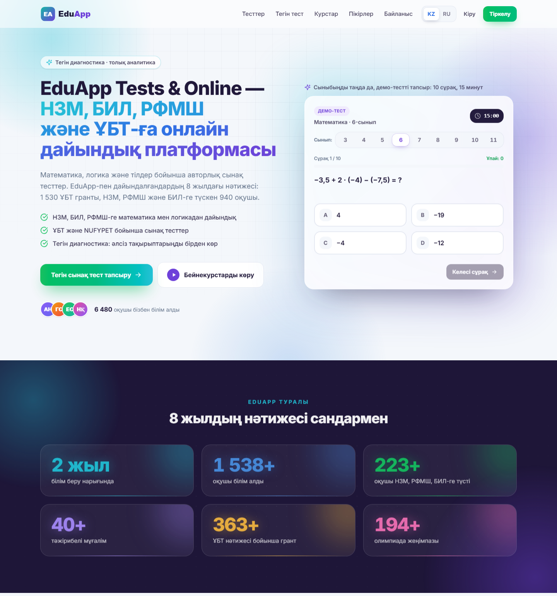

# EduApp Tests & Online — bilingual EdTech landing (React + SSG)

A fast, SEO-first landing page for an online school that prepares students for Kazakhstan's selective-school and university entrance exams (NIS / НЗМ, BIL, RPhMS, UNT). Built with React 19 and Tailwind CSS 4, pre-rendered to static HTML in Kazakh and Russian, with an interactive diagnostic test and a filterable test catalog.



## Features

- **Static pre-rendering (SSG)** — Vite SSR build + `prerender.mjs` produce ready HTML for 6 pages (home, catalog, register × kk/ru). Search engines get full text without JS; React hydrates afterwards.
- **Instant KZ ⇄ RU switch** — no reload, `history.pushState`, updates `<html lang>`, title, description, canonical; `/` and `/ru/` remain real crawlable URLs.
- **Works from `file://`** — the bundle is emitted as a single non-module script (`<script defer>`), so `dist/index.html` opens with a double click.
- **Demo test in the hero** — grade picker (3–11), 10 questions per grade, timer, result screen.
- **Free diagnostic wizard** — format → subject → track → short test → full analytics report (score ring, per-topic bars, strengths/weak spots, recommendations, answer table). Pure scoring functions in `src/diagnostic/report.js`; optional backend via `API_BASE`.
- **Test catalog page** — packages → sections → tests with instant filters (subject, grade, search) and hash-based state (`#kk/ubt/112`).
- **Registration page** — client-side validation, phone mask, password reveal, server error mapping; posts to a same-origin `/Account/Register` endpoint (shows a "preview" notice on localhost).
- **SEO** — per-language title/description, hreflang, Open Graph, JSON-LD (`EducationalOrganization`, `WebSite`, `ItemList`). See `docs/seo-matrix.md`.
- Sticky header with mobile menu, back-to-top with scroll progress, reveal animations, 3D tilt cards, reviews slider, video modal; respects `prefers-reduced-motion`.

## Tech stack

React 19 · Vite 8 (client + SSR builds) · Tailwind CSS 4 · Node.js prerender script · plain Python static server for local preview.

## Project structure

```
src/
  App.jsx, main.jsx, entry-server.jsx   app shell, hydration, SSR entry
  components/                           Header, Hero, TestPreview, Stats, Diagnostic, Products,
                                        Catalog, TestsPage, Courses, Reviews, CtaBand, Footer, RegisterPage…
  diagnostic/                           DiagnosticWizard, Report, report.js (scoring), questions.js, api.js
  i18n.js                               all texts (kk / ru)
  data.js                               links, demo reviews, videos, popular-tests snapshot
  seo.js                                <head> tags + JSON-LD
  tests-data.json                       catalog snapshot (RANDOM demo data, see scripts/)
public/img/                             placeholder logo, icons, illustrations
scripts/generate-demo-catalog.mjs       generates src/tests-data.json + section icons
prerender.mjs                           writes the 6 static HTML pages
docs/diagnostic-module.md               full spec of the diagnostic module (RU)
docs/seo-matrix.md                      SEO matrix: titles, headings, keyword clusters (RU)
serve.py / serve.bat                    no-cache local static server for dist/
```

## How to run (demo mode)

Requires Node.js 18+. Everything works offline — no API keys or backend needed.

```bash
npm install
npm run dev          # http://localhost:5173  (Russian: /ru/ or ?lang=ru)
npm run build        # static site in dist/
npm run preview      # http://localhost:4173
# or: python serve.py 8001   → http://localhost:8001

node scripts/generate-demo-catalog.mjs --seed 7   # regenerate the random catalog
```

Notes: course video IDs in `src/data.js` are placeholders (`VIDEO_ID_n`) — put your own YouTube IDs there. Registration and live "popular tests" only talk to a backend when the site runs on the platform's own domain.

> All data in this repository is randomly generated; brand names are anonymized. "EduApp", its logo, people, reviews, statistics, prices and contacts are fictional. School names (НЗМ/НИШ, БИЛ, РФМШ, ҰБТ) are public exam names.

## Қысқаша (KZ)

НЗМ, БИЛ, РФМШ және ҰБТ-ға дайындайтын онлайн-мектепке арналған екі тілді (қазақша / орысша) лендинг.
React 19 + Tailwind CSS 4, Vite арқылы статикалық HTML-ге пререндер жасалады — SEO-ға ыңғайлы.
Ішінде демо-тест, тегін диагностика мен толық аналитика, сүзгісі бар тесттер каталогы және тіркелу беті бар.
Іске қосу: `npm install`, кейін `npm run dev`. Барлық деректер кездейсоқ жасалған, бренд атаулары өзгертілген.
